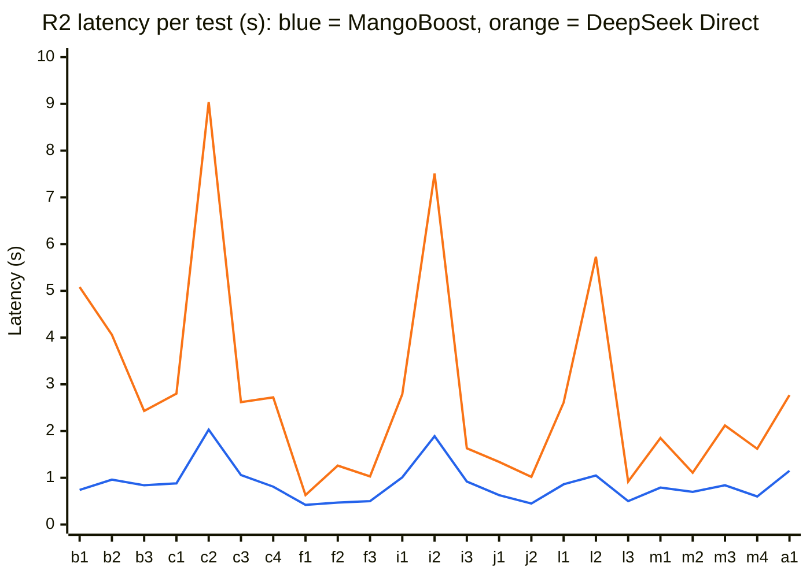
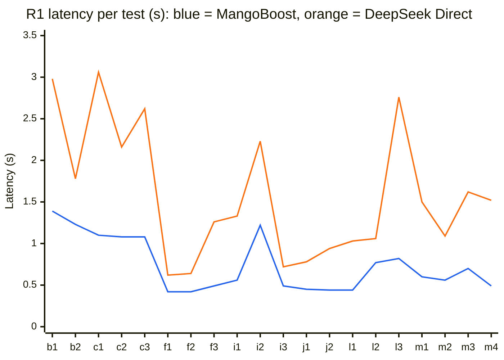

# DeepSeek V4.1 Flash: MangoBoost Inference vs DeepSeek Direct API

**Evaluation date:** 2026-11-26
**Objective:** Verify that DeepSeek V4.1 Flash served by MangoBoost Inference delivers output quality equivalent to the DeepSeek direct API (correct, coherent, no degraded output), and compare response latency.

## TL;DR

| Metric | MangoBoost | DeepSeek Direct |
|---|---|---|
| Pass rate (both rounds, 129 requests) | **128/129 (99.2%)** | **129/129 (100%)** |
| Degraded output (junk, truncation, repetition) | 0 | 0 |
| API errors | 0 | 0 |
| Mean latency, round 1 / round 2 | **0.71 s / 0.97 s** | 1.54 s / 2.37 s |
| p95 latency, round 1 / round 2 | **1.33 s / 2.02 s** | 2.98 s / 5.73 s |
| Byte-identical outputs at temperature 0 | 35/60 (R1), 37/69 (R2) | (shared metric) |

**Verdict:** The two endpoints showed no meaningful difference in quality, and the results are consistent with both serving the same model. The only gap is 1 failed run out of 129, a sporadic code-generation error that did not repeat on the same task. MangoBoost was **2.2x to 2.4x faster on mean latency** and **2.2x to 2.8x faster at p95**. Long-context behavior (above 16k tokens) has **not been tested yet**.

## Setup

| | A: MangoBoost | B: DeepSeek Direct |
|---|---|---|
| Endpoint | `https://api.mangoboost.io/v1` | `https://api.deepseek.com/v1` |
| Model ID | `deepseek-ai/DeepSeek-V4.1-Flash-1017` | `deepseek-flash` |
| API | OpenAI-compatible `/chat/completions` | OpenAI-compatible `/chat/completions` |
| Temperature | 0.0 | 0.0 |
| `max_tokens` | 2048 (R1), 4096 (R2) | 2048 (R1), 4096 (R2) |
| Runs per test | 3 | 3 |

Both providers received identical prompts. Each answer was graded automatically by a deterministic checker, with no LLM-as-judge:

- **math / logic:** the final numeric or categorical answer must match the reference (Indonesian and US number formats both accepted).
- **code:** the generated Python is executed against unit tests in an isolated subprocess.
- **json:** the output must parse as JSON and the extracted field values must match.
- **instruction:** format constraints are checked (line count, word limits, casing).
- **factual / bahasa:** required facts are present; Indonesian answers must not drift into English.
- **degradation detector:** flags empty output, `finish_reason=length`, repeated spans, stray CJK characters, and leaked control tokens (`<think>`, `<|...|>`, `</s>`).

| Round | Tests | Categories |
|---|---|---|
| R1 (baseline) | 20 | math, logic, code, json, instruction, factual, bahasa |
| R2 (harder) | 23 | R1 categories plus a harder code task (`eval_expr` recursive-descent parser), extra bahasa/code items, and a trap prompt |

## Results

### Accuracy by category

| Category | R1 MangoBoost | R1 DeepSeek | R2 MangoBoost | R2 DeepSeek |
|---|---|---|---|---|
| math | 12/12 | 12/12 | 12/12 | 12/12 |
| logic | 9/9 | 9/9 | 9/9 | 9/9 |
| code | 9/9 | 9/9 | **11/12** | 12/12 |
| json | 6/6 | 6/6 | 6/6 | 6/6 |
| instruction | 9/9 | 9/9 | 9/9 | 9/9 |
| factual | 9/9 | 9/9 | 9/9 | 9/9 |
| bahasa | 6/6 | 6/6 | 9/9 | 9/9 |
| trap | n/a | n/a | 3/3 | 3/3 |
| **Total** | **60/60** | **60/60** | **68/69** | **69/69** |

**Legend:** 🟦 **MangoBoost** (blue bars) &nbsp;&nbsp; 🟧 **DeepSeek Direct** (orange bars)

```mermaid
%%{init: {"themeVariables": {"xyChart": {"plotColorPalette": "#2563eb, #f97316"}}}}%%
xychart-beta
    title "Pass rate (%) by round: blue = MangoBoost, orange = DeepSeek Direct"
    x-axis ["R1 MangoBoost", "R1 DeepSeek Direct", "R2 MangoBoost", "R2 DeepSeek Direct"]
    y-axis "Pass rate (%)" 0 --> 100
    bar [100, 0, 98.6, 0]
    bar [0, 100, 0, 100]
```

The y-axis starts at 0 so the bars are not visually exaggerated. The only gap is R2: MangoBoost 98.6% (68/69) vs DeepSeek Direct 100% (69/69), one failed run.

### Latency per test, round 2

Mean latency per test (seconds), averaged over 3 runs. Lower is better.

**Legend:** 🟦 **MangoBoost** (blue line) &nbsp;&nbsp; 🟧 **DeepSeek Direct** (orange line)

### Latency per test, round 1

**Legend:** 🟦 **MangoBoost** (blue line) &nbsp;&nbsp; 🟧 **DeepSeek Direct** (orange line)

### Response time comparison

**Legend:** 🟦 **MangoBoost** (blue bars) &nbsp;&nbsp; 🟧 **DeepSeek Direct** (orange bars) &nbsp;&nbsp; *Shorter bar = faster response.*

```mermaid
%%{init: {"themeVariables": {"xyChart": {"plotColorPalette": "#2563eb, #f97316"}}}}%%
xychart-beta
    title "Average response time (seconds, lower is better)"
    x-axis ["R1 MangoBoost", "R1 DeepSeek Direct", "R2 MangoBoost", "R2 DeepSeek Direct"]
    y-axis "Seconds" 0 --> 2.5
    bar [0.71, 0, 0.97, 0]
    bar [0, 1.54, 0, 2.37]
```

```mermaid
%%{init: {"themeVariables": {"xyChart": {"plotColorPalette": "#2563eb, #f97316"}}}}%%
xychart-beta
    title "Slowest 5% of requests, p95 (seconds, lower is better)"
    x-axis ["R1 MangoBoost", "R1 DeepSeek Direct", "R2 MangoBoost", "R2 DeepSeek Direct"]
    y-axis "Seconds" 0 --> 6
    bar [1.33, 0, 2.02, 0]
    bar [0, 2.98, 0, 5.73]
```

### Response time by task type (round 2)

**Legend:** 🟦 **MangoBoost** (blue bars) &nbsp;&nbsp; 🟧 **DeepSeek Direct** (orange bars) &nbsp;&nbsp; *Shorter bar = faster response.*

MB = MangoBoost, DS = DeepSeek Direct. Each pair shows the average response time for one task type.

```mermaid
%%{init: {"themeVariables": {"xyChart": {"plotColorPalette": "#2563eb, #f97316"}}}}%%
xychart-beta
    title "R2 average response time by task type (seconds, lower is better)"
    x-axis ["Bahasa MB", "Bahasa DS", "Code MB", "Code DS", "Factual MB", "Factual DS", "Instruction MB", "Instruction DS", "JSON MB", "JSON DS", "Logic MB", "Logic DS", "Math MB", "Math DS", "Trap MB", "Trap DS"]
    y-axis "Seconds" 0 --> 4.5
    bar [0.85, 0, 1.2, 0, 0.46, 0, 1.27, 0, 0.54, 0, 0.8, 0, 0.73, 0, 1.15, 0]
    bar [0, 3.86, 0, 4.3, 0, 0.97, 0, 3.98, 0, 1.18, 0, 3.09, 0, 1.68, 0, 2.77]
```

**How to read it:** MangoBoost (blue) is shorter than DeepSeek Direct (orange) in every task type. The gap is smallest for short factual answers (0.46 s vs 0.97 s) and largest for long outputs such as code, instructions, and Indonesian paragraphs (3x to 4.5x faster).

Per-test speedup (DeepSeek Direct latency divided by MangoBoost latency):

| Round | Min speedup | Median speedup | Max speedup |
|---|---|---|---|
| R1 | 1.4x | 2.1x | 3.4x |
| R2 | 1.5x | 2.7x | 6.9x |

The speedup grows with output length. Short factual answers (f1 to f3) are 1.5x to 2.7x faster on MangoBoost. Long generations (c2, i2, l2, b1) are 4x to 7x faster, which points to higher decode throughput, not only lower network or queueing overhead.

## Analysis

### Quality equivalence

- **No accuracy gap.** Every category scored the same on both endpoints, except a single run of one code task.
- **Likely the same model.** At temperature 0, 54% to 58% of outputs were byte-identical across providers. Exact matches at this rate are unlikely if the weights, quantization level, or chat template differed. The remaining differences fit normal non-determinism from batching and GPU kernel scheduling, which also shows up within a single provider.
- **No serving artifacts.** There were zero truncations, repetition loops, stray CJK characters, or leaked special tokens on either side.

### The single failure (R2, `c2`, run 2 of 3)

The task was to implement `eval_expr(s: str) -> float`, a recursive-descent arithmetic parser. In MangoBoost's run 2 output, `parse_expr()` and `parse_term()` modify the enclosing index `i` (`i += 1`) without declaring `nonlocal i`, so the function raises `UnboundLocalError` at runtime. The DeepSeek output declares `nonlocal i` correctly in `parse_term()`.

This is a common LLM code-generation mistake, not a sign of serving degradation:
- The same task passed on MangoBoost runs 1 and 3.
- The output was syntactically complete and coherent (`finish_reason=stop`, no junk flags).
- One failure out of 129 requests (0.8%) is not statistically significant at this sample size.

### Latency

MangoBoost was faster on every one of the 43 tests across both rounds. Tail latency is the more relevant number for production: DeepSeek Direct's p95 rose from 2.98 s to 5.73 s on the harder set, while MangoBoost's stayed at about 2 s.

## Limitations

1. **Short-context only.** All prompts are under about 2k input tokens. Long-context retrieval and aggregation (16k to 128k tokens) are where quantization or KV-cache issues typically show up, and they have not been tested yet.
2. **Non-streaming latency.** Measured as end-to-end request time. Time-to-first-token (TTFT) and decode tokens/s were not isolated.
3. **No load testing.** Requests ran at low concurrency (≤4). Behavior under sustained high concurrency and rate limits is unknown.
4. **Single vantage point and time window.** All requests came from one client location (Jakarta) in one session on 2026-11-26. DeepSeek Direct latency is known to vary by time of day.
5. **Model alias.** DeepSeek Direct was called via the alias `deepseek-flash`. The high identical-output rate suggests it resolves to V4.1-Flash-1017, but this was not confirmed from DeepSeek documentation.
6. **Test difficulty.** Both endpoints scored near 100%, so the suite has a ceiling effect. It rules out gross degradation but cannot detect small quality differences.

## Recommendations

1. **Run the long-context suite** (needle retrieval at 10/50/90% depth and event aggregation, 4k to 128k tokens) before approving MangoBoost for production RAG or log-analysis workloads.
2. **Run a streaming benchmark** at concurrency 1, 4, and 16 to measure TTFT, decode tokens/s, and error rate under load.
3. **Repeat latency tests** at several times of day to separate provider performance from transient congestion.
4. **Rotate the MangoBoost API key** used for this evaluation, since it was shared over chat.

## Conclusion

For short-context workloads, MangoBoost Inference served DeepSeek V4.1 Flash with **the same output quality as the DeepSeek direct API** and **2x to 3x lower latency**, with no errors and no degraded outputs. Before production approval, the evaluation should be extended to long context and concurrent load.
